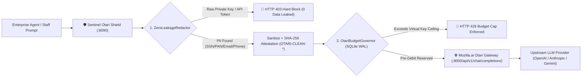

# 🛡️ Sentinel Otari Shield (`v1.0.0`)

**Enterprise Zero-Leakage PII/Secret Firewall & Pre-Debit FinOps Budget Governor built on [Mozilla.ai Otari](https://github.com/mozilla-ai/otari)**

[](#quick-start--verification)
[](https://github.com/mozilla-ai/otari)
[](LICENSE)

---

## 🎯 The Problem We Solve for Mozilla.ai Otari Users

[Mozilla.ai's **Otari**](https://github.com/mozilla-ai/otari) (`mzdotai/otari`) provides a unified, self-hosted LLM gateway (`/api/v1/chat/completions`) with virtual keys, cost tracking, and multi-provider routing (`OpenAI`, `Anthropic`, `Google Gemini`, `OpenRouter`, `Mistral`).

However, regulated enterprises (**US CPA & Accounting Firms**, **HIPAA Dental/Medical Clinics**, and **Web3 Corporate Treasuries**) face two critical blockers when connecting internal AI agents to external LLM providers:
1. **Unintended PII & Cryptographic Secret Leakage:** Staff or autonomous agents accidentally paste US Social Security Numbers (`SSN`), credit card `PAN` numbers, patient contact records, or raw `EVM`/`Solana`/`sk-...` secret keys into prompts before they leave the corporate perimeter.
2. **Post-Facto Spend Overruns:** Standard token accounting records cost *after* the upstream model responds, allowing runaway agent loops to exceed tenant virtual key budgets.

---

## ⚡ Architecture: How `Sentinel Otari Shield` Extends Otari



### Core Capabilities
- **Zero-Leakage Outbound Sanitization ([`otari_shield/redactor.py`](otari_shield/redactor.py)):**
  - Automatically redacts **US SSNs** (`[REDACTED:US_SSN]`), **Payment Card PANs** (`[REDACTED:PAYMENT_CARD_PAN]`), **Emails**, and **Phone Numbers** while emitting a deterministic `OTARI-CLEAN-<sha256>` cryptographic attestation header (`X-Otari-Shield-Attestation`).
  - **Hard-blocks (`HTTP 403`)** outbound requests containing 64-hex EVM private keys, Solana 64-byte keypair arrays, or `sk-...` / `ghp_...` / `Bearer` credentials before a single byte leaves the local machine.
- **Pre-Debit Virtual Key FinOps Governor ([`otari_shield/budget_governor.py`](otari_shield/budget_governor.py)):**
  - Atomically checks and reserves estimated token spend in a durable `SQLite WAL` ledger *before* forwarding to Mozilla.ai's Otari `/api/v1/chat/completions` endpoint, preventing runaway multi-agent loops (`HTTP 429`).
- **Interactive Judge & FinOps Console ([`otari_shield/static/index.html`](otari_shield/static/index.html)):**
  - Built-in dark-mode dashboard with 1-click verification presets for **US CPA Form 8949 Reconciliation**, **Clinical HIPAA Intake**, **Secret Leak Blocking**, and **Virtual Key Budget Overflow**.

---

## 🚀 Quick Start & Verification

### 1. Run Automated Test Suite (`pytest`)
```bash
pip install -r requirements.txt
pytest -v
```

### 2. Launch Interactive Console (`http://localhost:8090`)
```bash
uvicorn otari_shield.api:app --host 127.0.0.1 --port 8090
```
Or launch alongside Mozilla.ai's official `mzdotai/otari:latest` container via Docker Compose:
```bash
docker compose up --build
```

---

## 🏛️ Built by Sentinel Fleet Technologies
- **Author:** Luis Aguilar — Founder & CEO, [Sentinel Fleet Technologies](https://lamaaguilar9-web.github.io/sentinel-fleet/)
- **Contact:** `lamaaguilar9@gmail.com`
